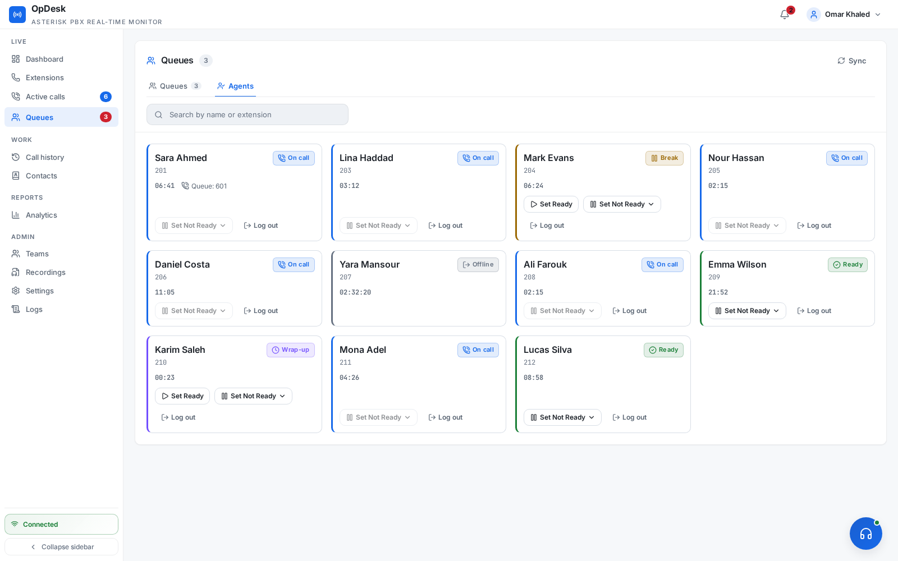
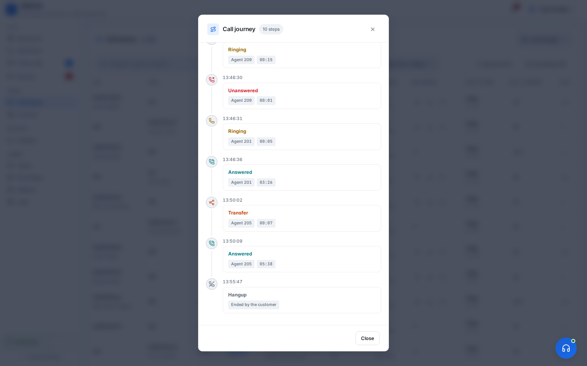
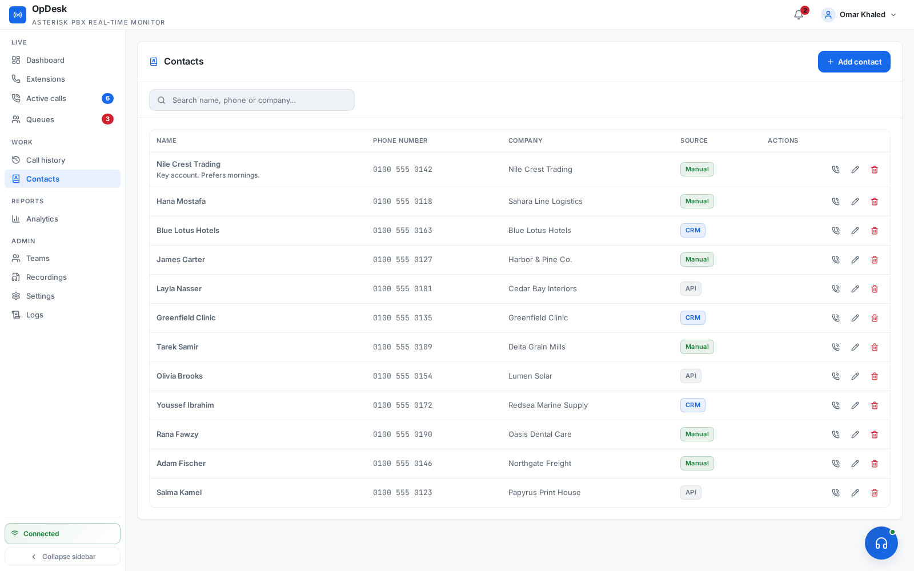

<div dir="rtl">

<<<<<<< HEAD
# Voiz Contact Center

### پنل حرفه‌ای مدیریت، پایش و تحلیل مرکز تماس مبتنی بر Asterisk
=======
A real-time operator panel for **Asterisk PBX** (Issabel 5 / FreePBX 16 and 17), like **FOP2** but built on React and NestJS. Monitor extensions and queues, manage live calls, browse CDR and recordings, take calls in the browser, and analyse call-center performance, all in one web app.

[](https://nodejs.org/)
[](https://nestjs.com/)
[](https://reactjs.org/)
[](docs/guides/installation.md#supported-systems)
[](LICENSE)
>>>>>>> upstream/main

[](https://github.com/voipiran/voiz-contact-center)
[](https://github.com/voipiran/voiz-contact-center)
[](https://fastapi.tiangolo.com/)
[](https://react.dev/)
[](https://www.asterisk.org/)
[](LICENSE)

**Voiz Contact Center** یک راهکار بومی و یکپارچه برای مدیریت مرکز تماس است که روی Asterisk اجرا می‌شود و اطلاعات تماس، داخلی‌ها، صف‌ها و عملکرد کارشناسان را در یک پنل وب مدرن در اختیار مدیران و کاربران قرار می‌دهد.

این پروژه بر پایه پروژه والد **[OpDesk](https://github.com/Ibrahimgamal99/OpDesk)** توسعه داده شده و برای محیط‌های فارسی‌زبان، چیدمان راست‌به‌چپ (RTL)، نیازهای عملیاتی مجموعه‌های ایرانی و کار با **Issabel / FreePBX** بهینه‌سازی شده است. کد و اسکریپت‌های این مخزن بسته‌بندی اختصاصی Voiz هستند؛ برای نصب، از دستورهای همین صفحه استفاده کنید.

</div>

---

## فهرست مطالب

<<<<<<< HEAD
- [معرفی کوتاه](#معرفی-کوتاه)
- [قابلیت‌ها](#قابلیت‌ها)
- [پیش‌نیازها](#پیشنیازها)
- [نصب سریع](#نصب-سریع)
- [راه‌اندازی اتصال مرکز تماس](#راهاندازی-اتصال-مرکز-تماس)
- [معماری و فناوری‌ها](#معماری-و-فناوریها)
- [ساختار پروژه](#ساختار-پروژه)
- [مستندات و پشتیبانی](#مستندات-و-پشتیبانی)
- [پروژه والد و مجوز](#پروژه-والد-و-مجوز)

## معرفی کوتاه

Voiz Contact Center برای تیم‌هایی طراحی شده است که می‌خواهند بدون جایگزین‌کردن Asterisk، یک لایه مدیریتی و عملیاتی کامل روی سیستم تلفنی خود داشته باشند. سامانه رویدادهای Asterisk را از طریق AMI دریافت می‌کند، وضعیت زنده را از طریق WebSocket به مرورگر می‌رساند و داده‌های تماس و گزارش‌ها را از طریق API در اختیار رابط کاربری قرار می‌دهد.

این راهکار برای استفاده در مرکز تماس، واحد فروش، پشتیبانی، نظرسنجی و تیم‌های خدمات مشتری مناسب است و می‌تواند در کنار تنظیمات فعلی Issabel یا FreePBX نصب شود.
=======
**Live operations**
- **Real-time panel**: extension status, active calls, queues and call notifications pushed over a WebSocket, with no polling.
- **Dashboard**: active, waiting and ringing calls, longest wait, agent availability and today's KPIs.
- **Supervision**: listen, whisper and barge, allowed per user.
- **Three roles**: **Admin** (everything), **Supervisor** (their assigned agents and queues), **Agent** (their own call history; live view of their groups).
- **Not-Ready codes**: agents pause with a reason. The reason is kept across device changes, wrap-up time is applied after calls, and adherence is reported per agent with a timeline.

**Calling**
- **Web softphone**: make and take calls in the browser over WebRTC, with hold, mute, transfer, queue login/logout, and Ready / Not Ready with a reason code.
- **Mobile softphone**: sign a phone in by scanning a QR code, and wake a closed app for incoming calls with **RFC 8599** push (FCM / APNs VoIP). Recommended app: [Medut Softphone](https://github.com/Ibrahimgamal99/medut-softphone). → [guide](docs/guides/mobile-push.md)
- **Recording**: full-call and per-leg recordings, with recording policy per direction and extension, retention, storage stats, and automatic talk/silence analysis (Silero VAD).

**History and analytics**
- **Call log**: whole-history search with one 10-value call status (Answered, Unanswered, Busy, Missed, Voicemail, Unreachable, Failure, Network error, Abandoned, Dropped), who ended the call, recording playback, QoS, CSV export, and a **Call Journey** timeline for multi-leg calls (IVR steps, transfers, listen / whisper / barge).
- **Analytics**: KPIs with period-over-period change, per-queue and per-agent breakdowns with compare charts, a 7×24 heatmap, agent adherence, and CSV export of every tab (plus XLSX for the drill-down). → [guide](docs/guides/analytics.md)
- **Contacts**: a shared phonebook that puts names on numbers everywhere, filled by hand or from your CRM. → [contract](docs/api/contact-lookup.md)

**Integration**
- **CRM push**: send call data to any CRM (API key, Basic, Bearer or OAuth2) with your own field names and outcome values. Every delivery is logged and can be resent. → [contract](docs/api/webhooks.md)
- **REST API**: scoped API keys for live state, call history and analytics, plus click-to-call and softphone account lookup. → [reference](docs/api/endpoints.md)
- **Logs**: a live AMI event console, SIP trace, CRM delivery log, and an **audit log** of every change made through the UI or API.
>>>>>>> upstream/main

## قابلیت‌ها

### مدیریت و پایش لحظه‌ای

- داشبورد زنده برای وضعیت داخلی‌ها، تماس‌های فعال، صف‌ها و کارشناسان
- نمایش تماس‌های در حال زنگ‌خوردن، پاسخ‌داده‌شده و در انتظار
- مشاهده طولانی‌ترین زمان انتظار و شاخص‌های کلیدی روزانه
- به‌روزرسانی رویدادها با WebSocket و بدون وابستگی به polling مداوم
- پشتیبانی از نقش‌های مدیریتی و سطح دسترسی کاربران

### کنترل تماس و نظارت کارشناسان

- برقراری و دریافت تماس از داخل مرورگر با WebRTC و SIP.js
- نگه‌داشتن تماس، بی‌صداکردن، انتقال و کنترل وضعیت آماده / غیرآماده
- ورود و خروج کارشناس از صف
- شنود تماس، Whisper و Barge با سطح دسترسی کنترل‌شده
- پشتیبانی از Softphone موبایل و تولید QR برای ورود سریع
- ضبط مکالمات و تحلیل سکوت / گفت‌وگو با VAD

<<<<<<< HEAD
### گزارش‌گیری و تحلیل
=======
| Agent board | Call log | Call Journey |
|---|---|---|
| [](screenshots/agent_board.png) | [](screenshots/call_log.png) | [](screenshots/call_journey.png) |

| Recordings | Contacts | Dark theme |
|---|---|---|
| [](screenshots/recordings.png) | [](screenshots/contacts.png) | [](screenshots/dashboard_dark.png) |
>>>>>>> upstream/main

- تاریخچه کامل تماس‌ها و جست‌وجوی چندمعیاره
- نمایش مسیر تماس (Call Journey) برای تماس‌های چندمرحله‌ای
- گزارش عملکرد صف‌ها و کارشناسان
- شاخص‌های KPI، تغییرات دوره‌ای و نمودارهای تحلیلی
- خروجی CSV و XLSX
- تحلیل کیفیت تماس و دسترسی به فایل ضبط‌شده

### ارتباط با CRM و API

<<<<<<< HEAD
- دفترچه تلفن متمرکز و نمایش نام مخاطب در پنل
- ارسال اطلاعات تماس به CRM از طریق Webhook
- ثبت لاگ ارسال‌ها و امکان ارسال مجدد
- REST API با کلیدهای دسترسی و Scope
- Click-to-Call و دریافت اطلاعات مخاطب از CRM
- لاگ رویدادهای AMI، Trace مربوط به SIP و رخدادهای CRM
=======
| Mobile Wake settings |   |   |
|---|---|---|
| [](screenshots/mobile_wake.png) |   |   |
>>>>>>> upstream/main

### رابط کاربری فارسی

- بهینه‌شده برای زبان فارسی و چیدمان RTL
- طراحی واکنش‌گرا برای دسکتاپ، تبلت و موبایل
- پشتیبانی از حالت روشن و تاریک
- تمرکز بر خوانایی، دسترسی سریع و استفاده عملیاتی در محیط مرکز تماس

<<<<<<< HEAD
## پیش‌نیازها

| مورد | توضیح |
|---|---|
| سیستم تلفنی | Issabel یا FreePBX مبتنی بر Asterisk |
| دسترسی Asterisk | فعال‌بودن AMI روی پورت `5038` و HTTP/WebSocket روی پورت `8088` |
| سیستم‌عامل | Debian 12+، Ubuntu یا توزیع‌های خانواده RHEL |
| دسترسی نصب | دسترسی `root` یا کاربری دارای `sudo` |
| پایگاه داده | MySQL یا MariaDB و دسترسی به دیتابیس‌های Asterisk و CDR |
| ابزارهای پایه | `curl` و `openssl`؛ اسکریپت نصب فقط ابزارهای ضروریِ مفقود را نصب می‌کند |
| نصب عمومی | برای HTTPS عمومی، دامنه‌ای که به سرور اشاره کند و دسترسی پورت ۸۰ برای Let's Encrypt |
=======
- **Issabel 5** (Rocky Linux 8) or **FreePBX 16 / 17** (Debian 12, Debian 10/11, Rocky/Alma 8), or plain Asterisk, with **AMI** enabled and the Asterisk HTTP server on port 8088 (the installer checks it).
- **MySQL / MariaDB**: the PBX's own database server.
- **glibc 2.28 or newer** for Node.js 24. FreePBX 16 on Sangoma Linux 7 / CentOS 7 (glibc 2.17) runs OpDesk through [Docker](docs/guides/installation.md#option-b-docker) instead.
- **Root** (`sudo`) and `curl`. The installer adds Node.js 24 (nvm), nginx, a small Python venv for voice-activity analysis, and the other tools it needs.
- **For a public install**: a DNS name pointing at the server, with port 80 reachable for Let's Encrypt.

> **Port 443 is usually taken.** The PBX's Apache serves its own web UI:
> - **Issabel 5**: Apache keeps 80 and 443, and the installer never moves it. OpDesk is served on **`8443`**, and Let's Encrypt validates through Apache's web root.
> - **FreePBX 16 / 17**: Apache holds 80, and 443 too once HTTPS is set up there. OpDesk then defaults to **`8443`**. The installer can instead move Apache from 443 to `4443`.
>
> See [Ports](docs/guides/installation.md#ports).
>>>>>>> upstream/main

> **نکته پورت‌ها:** در Issabel و FreePBX معمولاً Apache پورت‌های ۸۰ و ۴۴۳ را در اختیار دارد. اسکریپت نصب در صورت نیاز پورت جایگزین HTTPS (پیش‌فرض `8443`) را پیشنهاد می‌کند. پیش از نصب، وضعیت سرویس‌های فعال و فایروال را بررسی کنید.

## نصب سریع

### روش پیشنهادی: دریافت نسخه اصلی با tarball

دستور زیر را روی سرور PBX اجرا کنید:

```bash
<<<<<<< HEAD
cd /opt && \
rm -rf voiz-contact-center voiz-contact-center.tar.gz && \
curl -fL https://github.com/voipiran/voiz-contact-center/archive/refs/heads/main.tar.gz \
  -o voiz-contact-center.tar.gz && \
tar -xzf voiz-contact-center.tar.gz && \
mv voiz-contact-center-main voiz-contact-center && \
cd voiz-contact-center && \
sudo bash install.sh
```

### روش جایگزین: دریافت با Git
=======
curl -fsSLO https://raw.githubusercontent.com/Ibrahimgamal99/OpDesk/main/install.sh
chmod +x install.sh

sudo ./install.sh                                                                  # LAN, self-signed certificate
sudo OPDESK_DOMAIN=opdesk.example.com OPDESK_LE_EMAIL=admin@example.com ./install.sh   # public, Let's Encrypt
```

The installer clones to `/opt/OpDesk`. It sets up Node.js 24, the database user and schema, the AMI user, nginx, the certificate and the `opdesk` systemd service, then builds and starts OpDesk. Add `--yes` for an unattended run.

Then:

1. Open **`https://<server>`** (add `:8443` or whichever port you chose if it isn't 443).
2. Sign in as **`admin`** with the password you entered, or the default `OpDesk@2026` if you pressed Enter. Change it from the profile menu.
3. Under **Users**, link users to their extensions so they get a softphone.

**To update**, re-run `sudo ./install.sh` from `/opt/OpDesk`. Your settings and port are kept. **To uninstall**, run `sudo ./install.sh --uninstall` ([what it removes](docs/guides/installation.md#uninstalling)). Upgrading from the Python backend (1.x)? See [the upgrade notes](docs/guides/installation.md#upgrading-from-the-python-backend-opdesk-1x).

**Docker**:
>>>>>>> upstream/main

```bash
sudo rm -rf /opt/voiz-contact-center
sudo git clone --depth 1 https://github.com/voipiran/voiz-contact-center.git \
  /opt/voiz-contact-center
cd /opt/voiz-contact-center
sudo bash install.sh
```

<<<<<<< HEAD
اسکریپت `install.sh` محیط لازم را آماده می‌کند، نسخه bundled برنامه را در مسیر عملیاتی `/opt/OpDesk` قرار می‌دهد، Node.js و Python مورد نیاز را بررسی / نصب می‌کند و سرویس‌های لازم را برای اجرا آماده می‌سازد. نصب‌کننده به‌صورت عمدی کد را از پروژه والد Clone نمی‌کند؛ نسخه هماهنگ‌شده Voiz از همین مخزن استفاده می‌شود.
=======
The container uses host networking and serves HTTP on `127.0.0.1:8765`. Put nginx in front of it for TLS, using [`nginx/opdesk.conf.example`](nginx/opdesk.conf.example). The database user, schema and AMI user are created on the host: see [Docker](docs/guides/installation.md#option-b-docker).
>>>>>>> upstream/main

در ابتدای نصب، اگر `curl` و `openssl` از قبل روی سیستم موجود باشند، هیچ بسته‌ای برای ابزارهای پایه نصب نمی‌شود. نصب Python، Nginx و وابستگی‌های runtime در مراحل بعدی و فقط در صورت نیاز انجام می‌شود؛ در آن مراحل مدیر بسته سیستم‌عامل ممکن است متادیتای Repositoryهای فعال را بررسی کند.

### اجرای مستقیم نسخه موجود در مخزن

اگر پروژه از قبل روی سرور قرار دارد:

<<<<<<< HEAD
```bash
cd /opt/voiz-contact-center
sudo bash install.sh
=======
```mermaid
flowchart LR
    Browser["Browser<br/>React app + WebRTC softphone"] -- "HTTPS / WSS" --> Nginx["nginx :443 or :8443<br/>TLS"]
    Nginx -- "/ · /api · /ws" --> API["NestJS (Node.js 24)<br/>127.0.0.1:8765"]
    Nginx -- "/sip-ws" --> AstWS["Asterisk HTTP / WS<br/>127.0.0.1:8088"]
    API -- "AMI :5038" --> Asterisk["Asterisk<br/>(Issabel / FreePBX)"]
    API -- "SQL" --> DB[("MySQL / MariaDB<br/>asterisk · asteriskcdrdb · OpDesk")]
    AstWS --- Asterisk
    Phone["Mobile softphone<br/>(Medut)"] -- "SIP TLS / TCP / UDP" --> Asterisk
    API -. "FCM / APNs wake push" .-> Phone
    API -. "call data" .-> CRM["Your CRM"]
>>>>>>> upstream/main
```

> اجرای نصب با `sudo` توصیه می‌شود، چون اسکریپت با مسیرهای سیستمی، تنظیمات Asterisk و سرویس‌های سیستم‌عامل کار می‌کند.

## راه‌اندازی اتصال مرکز تماس

اسکریپت `contactcenter.sh` تنظیمات تکمیلی اتصال Voiz به Asterisk را انجام می‌دهد. این مرحله را بعد از نصب اصلی اجرا کنید:

```bash
cd /opt/voiz-contact-center
sudo bash contactcenter.sh
```

این اسکریپت در صورت امکان اطلاعات اتصال دیتابیس Issabel / FreePBX را تشخیص می‌دهد و تنظیمات مورد نیاز ChanSpy و Feature Codeهای نظارت تماس را در Asterisk اعمال می‌کند. اگر اطلاعات دیتابیس به‌صورت خودکار پیدا نشود، اسکریپت آن‌ها را به‌صورت تعاملی درخواست می‌کند.

پس از پایان نصب:

1. آدرس نمایش‌داده‌شده توسط نصب‌کننده را در مرورگر باز کنید؛ معمولاً `https://<server>` یا `https://<server>:8443` است.
2. با کاربر مدیری که نصب‌کننده اعلام می‌کند وارد شوید و رمز پیش‌فرض را تغییر دهید.
3. در بخش کاربران، هر کاربر را به داخلی و صف‌های مربوط به خود متصل کنید.
4. تنظیمات AMI، دیتابیس، دامنه و HTTPS را بررسی کنید.
5. برای اطمینان، یک تماس آزمایشی برقرار و تاریخچه، ضبط و وضعیت صف را بررسی کنید.

## تنظیمات مهم

فایل نمونه تنظیمات در [.env.example](.env.example) قرار دارد. مهم‌ترین موارد عبارت‌اند از:

| متغیر | کاربرد |
|---|---|
<<<<<<< HEAD
| `DB_HOST`، `DB_USER`، `DB_PASSWORD` | اتصال به MySQL / MariaDB |
| `DB_NAME`، `DB_CDR` | دیتابیس تنظیمات و تاریخچه تماس |
| `AMI_HOST`، `AMI_PORT`، `AMI_USERNAME`، `AMI_SECRET` | اتصال مدیریتی به Asterisk |
| `PORT` | پورت داخلی Backend |
| `OPDESK_HTTPS_PORT`، `NGINX_HTTPS_PORT` | پورت سرویس HTTPS |
| `JWT_SECRET` | کلید امضای نشست‌ها؛ باید طولانی و تصادفی باشد |
| `ASTERISK_RECORDING_ROOT_DIR` | مسیر فایل‌های ضبط مکالمه |
| `FCM_*` و `APNS_*` | تنظیمات اختیاری اعلان بیدارباش Softphone موبایل |
=======
| **React frontend** | The panel. Live state arrives over the `/ws` WebSocket; history and settings use the REST API. The softphone registers to Asterisk through `/sip-ws`. |
| **NestJS backend** | Node.js 24, TypeScript. Keeps one AMI connection, turns Asterisk events into presence, queue and call events, and sends each user the part their role may see. Serves the REST API and the built frontend, and pushes call data to your CRM. A small Python helper analyses recordings for talk and silence. |
| **Asterisk** | Still owns the dialplan. OpDesk uses AMI for monitoring and call control (originate, transfer, listen / whisper / barge). |
| **nginx** | Terminates TLS (the browser needs HTTPS for the microphone) and proxies to the backend and to Asterisk. |
| **Database** | Reads the PBX's `asterisk` config and `asteriskcdrdb` CDR (FreePBX and Issabel use the same names). Its own database holds users, groups, contacts, settings, API keys, the CRM delivery log and analytics rollups. Call history is read from the CDR, not copied. |
>>>>>>> upstream/main

اطلاعات حساس، کلیدهای سرویس و فایل‌های APNs / FCM را در Git Commit نکنید.

## معماری و فناوری‌ها

```text
مرورگر (React + WebRTC)
        │ HTTPS / WSS
        ▼
Nginx ───────► FastAPI / Uvicorn ───────► Asterisk
                  │   │                     │
                  │   ├── MySQL / MariaDB  ├── AMI
                  │   ├── CRM Webhook      └── SIP / RTP
                  │   └── تحلیل تماس
                  └── REST API + WebSocket
```

| لایه | فناوری‌ها |
|---|---|
<<<<<<< HEAD
| Backend | Python 3.11+، FastAPI، Uvicorn، asyncio، WebSocket |
| Frontend | React 18، TypeScript، Vite، React Router |
| تلفن تحت وب | SIP.js، WebRTC و Asterisk HTTP/WebSocket |
| پایگاه داده | MySQL / MariaDB، دیتابیس Asterisk و CDR |
| احراز هویت | JWT و bcrypt |
| گزارش‌گیری | Recharts، openpyxl و خروجی CSV/XLSX |
| تحلیل صوت | WebRTC VAD و ONNX Runtime |
| استقرار | Nginx، systemd، HTTPS و Let's Encrypt |
=======
| **Backend** | Node.js 24, NestJS 11 (Express 5), TypeScript, `ws` WebSockets, mysql2 (MySQL/MariaDB), bcryptjs + JWT, zod validation, exceljs (XLSX export), web-push; Python venv with onnxruntime + WebRTC VAD for talk/silence analysis |
| **Frontend** | React 18, TypeScript, Vite, SIP.js (WebRTC), Recharts, Framer Motion, Lucide icons, react-i18next |
| **Telephony** | Asterisk AMI, Asterisk HTTP/WebSocket (SIP over WSS), RFC 8599 push via FCM and APNs, VAPID Web Push |
| **Deployment** | nginx, systemd, Let's Encrypt (Debian, Rocky 8 / Issabel 5); or Docker Compose |
>>>>>>> upstream/main

### اجرای توسعه‌ای

برای کار روی Frontend و Backend به‌صورت محلی:

<<<<<<< HEAD
```bash
cd /opt/voiz-contact-center
bash start.sh --dev
```
=======
| Guide | What it covers |
|---|---|
| [Installation](docs/guides/installation.md) | Supported systems (Issabel 5, FreePBX 16/17), ports and Apache, native and Docker installs, running, updating, troubleshooting. |
| [Configuration](docs/guides/configuration.md) | `backend/.env`, the Settings page, roles and visibility, audit log, debugging. |
| [Mobile softphone](docs/guides/mobile-push.md) | QR sign-in, RFC 8599 wake-up, Firebase and APNs setup. |
| [Analytics](docs/guides/analytics.md) | Every KPI, how it is computed, and how to tune it. |
| [API overview](docs/api/overview.md) · [Endpoints](docs/api/endpoints.md) | Authentication, API keys and scopes, and every endpoint. |
| [CRM push](docs/api/webhooks.md) · [Contact lookup](docs/api/contact-lookup.md) | The outgoing call-data push and the incoming contact lookup. |
>>>>>>> upstream/main

برای اجرای Production، Frontend باید از قبل Build شده باشد:

```bash
cd /opt/voiz-contact-center/frontend
npm ci
npm run build

cd ..
bash start.sh --production
```

در نصب production، `start.sh` عمداً Frontend را روی سرور Build نمی‌کند و از `frontend/dist` آماده استفاده می‌کند.

## ساختار پروژه

```text
voiz-contact-center/
├── backend/             # API، اتصال AMI، منطق تماس و تحلیل
├── frontend/            # رابط کاربری React و TypeScript
├── nginx/               # نمونه تنظیمات Reverse Proxy
├── screenshots/         # تصاویر معرفی رابط کاربری
├── docs/                # راهنماهای فنی و API
├── contactcenter.sh     # تنظیمات تکمیلی Asterisk و ChanSpy
├── install.sh           # نصب و آماده‌سازی محیط
└── start.sh             # اجرای توسعه‌ای و production
```

## مستندات و پشتیبانی

- [راهنمای نصب و عیب‌یابی](docs/guides/installation.md)
- [راهنمای تنظیمات](docs/guides/configuration.md)
- [راهنمای تحلیل و KPI](docs/guides/analytics.md)
- [راهنمای Softphone و Push موبایل](docs/guides/mobile-push.md)
- [مرجع API](docs/api/overview.md) و [فهرست Endpointها](docs/api/endpoints.md)
- [Webhookهای CRM](docs/api/webhooks.md) و [جست‌وجوی مخاطب](docs/api/contact-lookup.md)

برای گزارش خطا، نسخه Issabel / FreePBX، نسخه Asterisk، روش نصب و لاگ مرتبط سرویس را همراه با گزارش خود در [Issues گیت‌هاب](https://github.com/voipiran/voiz-contact-center/issues) ارسال کنید. رمزها، کلیدهای API و اطلاعات شخصی تماس‌ها را در Issue قرار ندهید.

## پروژه والد و مجوز

این پروژه از نظر ایده و بخش‌هایی از معماری بر پایه **[OpDesk](https://github.com/Ibrahimgamal99/OpDesk)** شکل گرفته است. Voiz Contact Center یک نسخه سفارشی‌سازی‌شده برای محیط فارسی و زیرساخت‌های رایج VoIP در ایران است و تغییرات بسته‌بندی، نصب، رابط کاربری و یکپارچه‌سازی خود را در همین مخزن نگه می‌دارد.

کد این پروژه تحت مجوز **[GNU GPL v3](LICENSE)** منتشر شده است. هنگام استفاده، تغییر یا توزیع مجدد، شرایط مجوز و اعلان‌های حق‌نشر وابستگی‌ها را رعایت کنید.
